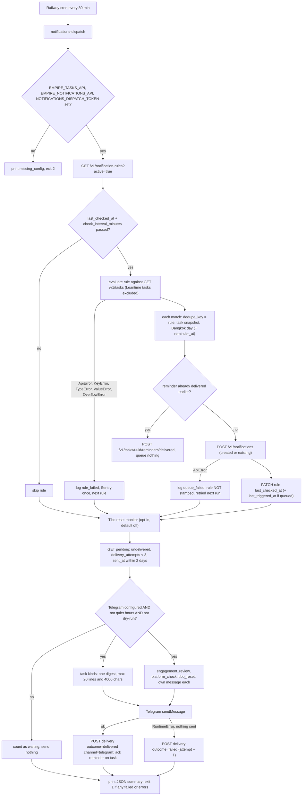
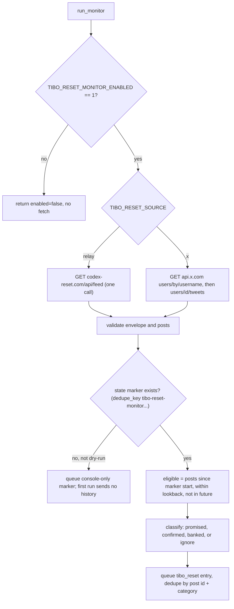

# 01 — Business process (As-Is / To-Be)

## As-Is: จากงาน (task) ถึงข้อความ Telegram (ตามโค้ดวันนี้)

ทุก 30 นาที Railway cron รัน `notifications-dispatch` หนึ่งครั้ง: (1) ประเมินกฎที่ active และถึงรอบ (2) Tibo reset monitor ถ้าเปิด (3) ส่งรายการที่ค้างทาง Telegram นอก quiet hours

Sources: `src/solo_notifications/dispatch.py` (`main`, `run_rules`, `evaluate`, `due`, `deliver`, `digest`, `quiet`), `src/solo_notifications/tibo_reset.py` (`run_monitor`), `.railway/railway.ts`

ข้อเท็จจริงสำคัญจากโค้ด:

- quiet hours = 22:00–07:00 Asia/Bangkok (`QUIET = (22, 7)`) ตรวจก่อนส่ง **ทุก batch** (`quiet(clock())`) ไม่ใช่แค่ตอนเริ่ม
- `MAX_ATTEMPTS = 3` ใช้เป็นตัวกรอง `max_attempts` ตอนดึง pending: entry ที่ล้มเหลวครบ 3 ครั้งจะไม่ถูกหยิบอีก (ไม่มีการแจ้งเตือนแยก)
- pending ดึงเฉพาะ `sent_at` ภายใน 2 วันที่ผ่านมา: entry ที่ค้างเกิน 2 วันไม่ถูกส่งอีก (gap: ไม่มีการรายงาน)
- กฎ `status_change` มีใน schema / API แต่ `evaluate()` คืน `[]` สำหรับชนิดนี้ (gap: ยังไม่ implement ใน dispatcher)

## As-Is: Tibo reset monitor (opt-in)

Sources: `src/solo_notifications/tibo_reset.py` (`Settings.from_env`, `fetch_posts`, `parse_relay`, `classify`, `matches`, `_alert`, `run_monitor`), `README.md` §Tibo reset alerts

## To-Be (จากเอกสารใน repo เท่านั้น)

- `PRODUCT.md` §Measures: due reminders ส่งภายใน 1 รอบนอก quiet hours (เป้า: ทั้งหมด), entry ที่ล้มเหลวครบ 3 ครั้ง (เป้า: 0), ข้อความใน quiet hours (เป้า: 0), 5xx และ p95 latency ของ `/v1/notifications`
- `PRODUCT.md` §Capabilities: out of scope = ช่องทางอื่นนอก Telegram และ preference ต่อคน
- `specs/001-l2-baseline/spec.md`: ไม่มีพฤติกรรมใหม่ (tooling, lock, tests เท่านั้น); รีวิว 2026-10-24 ขอให้แก้ตาราง §4 ที่เสีย

## Open questions

- To-Be ของกระบวนการ (เช่น channel ใหม่, การแจ้งเมื่อ entry ล้มเหลวครบ 3 ครั้ง, การจัดการ entry ที่เกิน 2 วัน) ไม่มีใน PRODUCT.md / specs / issues — ต้องให้ owner กำหนด
- กฎ `status_change` ตั้งใจให้ dispatcher รองรับหรือไม่ (ตอนนี้ถูกข้ามแบบเงียบ)
- `TIBO_RESET_MONITOR_ENABLED` ใน production เปิดอยู่หรือไม่ (PRODUCT.md ระบุ `[ต้องยืนยัน]`; registry บอกว่า staged แต่ยังไม่ live)
