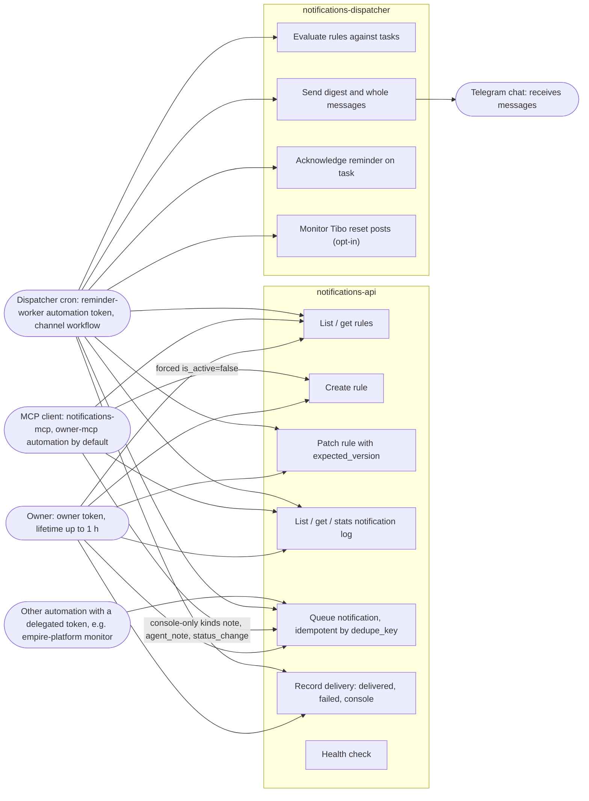

# 02 — Use cases

Actors มาจากโค้ดจริง: token RS256 ที่ `auth.py` ตรวจ (audience `notifications-api`, channel `api|mcp|workflow|cli|event`) และ permission 4 ตัวที่ `app.py` ถาม empire-platform (`notifications.rule:read|write`, `notifications.notification:read|write`) ไม่มีผู้ใช้ภายนอก

Sources: `src/solo_notifications/auth.py` (`AUDIENCE`, `CHANNELS`, `MAX_LIFETIME_SECONDS`, `HARD_MAX_LIFETIME_SECONDS`), `src/solo_notifications/app.py` (routes + `allow`), `src/solo_notifications/mcp_server.py` (`build_server`, `NoteKind`, `bearer`), `src/solo_notifications/dispatch.py`, `PRODUCT.md` §Users, platform-empire `src/empire_platform/monitor.py` (writes via `EMPIRE_NOTIFICATIONS_API`)

## หมายเหตุ

- `/health` ไม่ต้องใช้ token (UC7) — ผู้เรียกจริงคือ `platform-uptime-worker` และ Railway healthcheck
- ไม่มี use case สำหรับลบ rule / ลบ log (ไม่มี DELETE route; runtime role ไม่มีสิทธิ์ DELETE ใน migration)
- MCP ไม่มี `rule.update` โดยตั้งใจ (`AGENTS.md`, `tests/test_mcp.py::test_there_is_no_rule_update_tool_so_an_active_rule_cannot_be_widened`)
- คอลัมน์ `read_at` / `dismissed_at` มีใน schema แต่ไม่มี route ไหนตั้งค่า (gap)

## Open questions

- ใครเขียน entry ชนิด `engagement_review` (dispatcher ส่งชนิดนี้ แต่ไม่พบผู้เขียนใน repo นี้; `platform_check` มาจาก empire-platform `monitor.py`)
- README ระบุ MCP default automation = `owner-cli` แต่โค้ด `bearer()` ใช้ `owner-mcp` (docstring ก็บอก `owner-mcp`) — README ล้าสมัย
