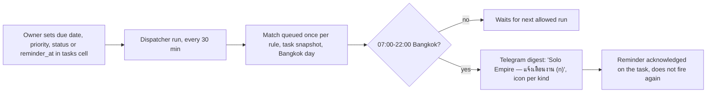
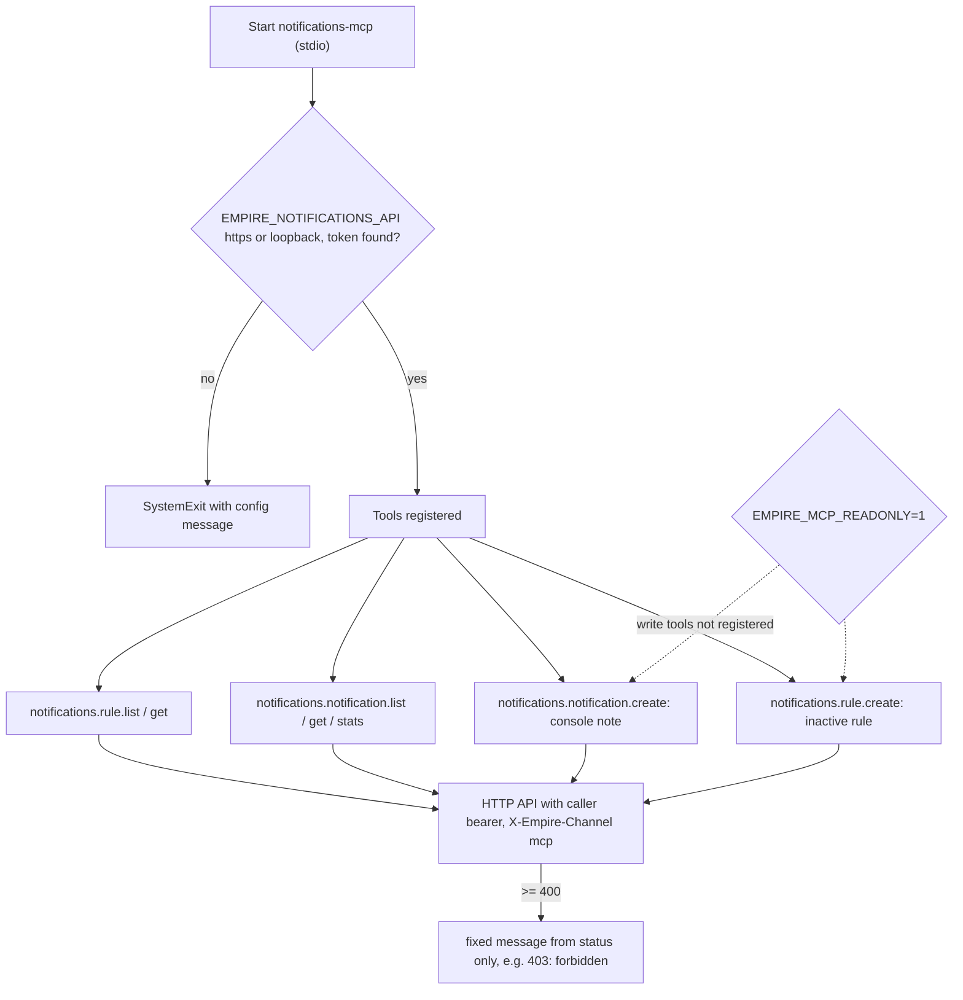
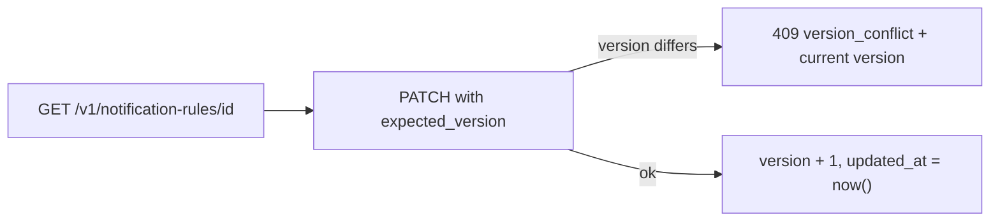

# 03 — User flows

ไม่มี UI: "ผู้ใช้" คือ owner ผ่าน MCP / CLI client และ Telegram ฝั่งรับ ด้านล่างคือ flow หลักต่อ role ตาม route และ tool ที่มีจริง

## Flow A — Owner รับแจ้งเตือนงาน (Telegram)

Sources: `src/solo_notifications/dispatch.py` (`evaluate`, `run_rules`, `quiet`, `digest`, `ICONS`, `deliver`)

## Flow B — Owner / agent ดูและจัดการผ่าน MCP

Sources: `src/solo_notifications/mcp_server.py` (`api_url`, `bearer`, `Toolbox.call`, `failure`, `build_server`, `main`), `.mcp.json`

## Flow C — Owner เปลี่ยนกฎ (HTTP เท่านั้น)

Sources: `src/solo_notifications/app.py` (`update_rule`)

## Flow D — Tibo reset preview (ไม่เขียนอะไร)

`python -m solo_notifications.tibo_reset --preview` อ่าน relay สาธารณะครั้งเดียว พิมพ์ JSON ของ match 48 ชั่วโมงล่าสุด ไม่แตะ notifications API ไม่อ่าน bot config

Sources: `src/solo_notifications/tibo_reset.py` (`main`), `README.md`

## Open questions

- Client `ops-toolkit infra/scripts/utils/notifications_store.py` (PRODUCT.md) และ hub `platform-mcp-remote-worker` ไม่ได้อ่านในรอบนี้ — flow ฝั่งนั้นไม่ได้วาด
