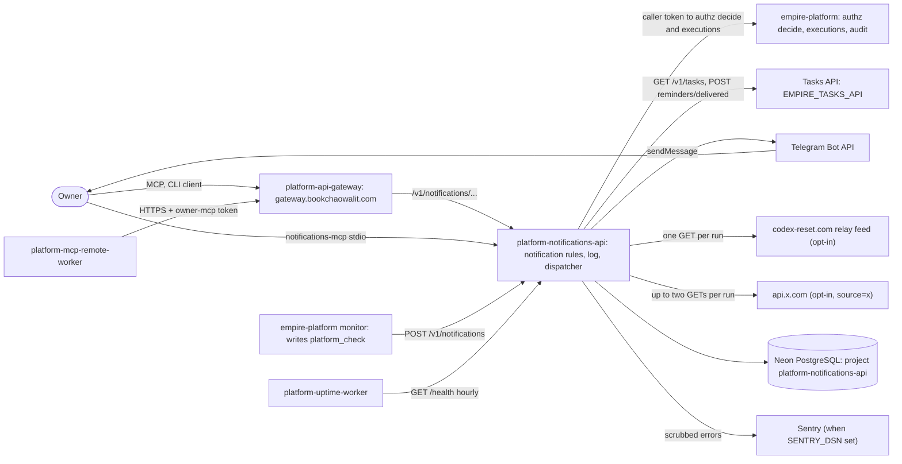

# 05 — C4 Context

> ใช้ flowchart แทน `C4Context` เพื่อให้ label ยาว render บน GitHub ได้

Sources: `README.md`, `PRODUCT.md` §Users / §Operating Context, `src/solo_notifications/platform.py`, `src/solo_notifications/dispatch.py` (`Tasks`, `telegram_sender`), `src/solo_notifications/tibo_reset.py` (`RELAY_URL`, `fetch_posts`), `src/solo_notifications/_sentry.py`, `src/solo_notifications/db.py`, platform-uptime-worker `src/targets.ts` (`notifications-api`, in `SLEEPS`), platform-empire `src/empire_platform/monitor.py`, ops record: api-gateway-edge (2026-11-03) — owner CLI `client.env` and remote MCP hub point `notifications` at the gateway

## Open questions

- Dispatcher ใช้ `EMPIRE_NOTIFICATIONS_API` / `EMPIRE_TASKS_API` ค่าใดใน Railway (ตรงหรือผ่าน gateway) — เป็น Railway variable ไม่อยู่ใน repo
- ops record api-gateway-edge ระบุ `tasks→empire-platform` (Tasks API อยู่ใน empire-platform) — ยืนยันสำหรับ dispatcher ไม่ได้จาก repo นี้
