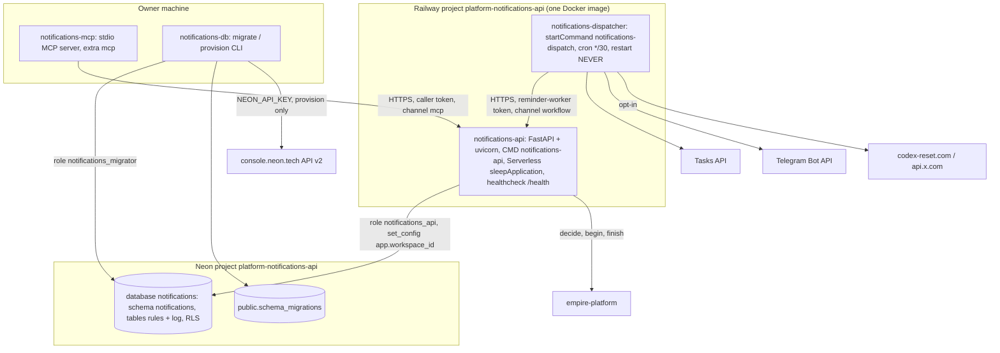

# 06 — C4 Container

Sources: `.railway/railway.ts`, `Dockerfile`, `pyproject.toml` (`[project.scripts]`, extras), `src/solo_notifications/app.py` (`main`, `bound`), `src/solo_notifications/db.py` (`HostedCluster`, `migrate`, `provision`, `NEON_API`), `src/solo_notifications/dispatch.py` (`Http`, `main`), `src/solo_notifications/mcp_server.py`, `.mcp.json`, `migrations/0001_notifications.sql`

หมายเหตุ: dispatcher ไม่ต่อ DB ตรง — ทุก read/write ผ่าน HTTP API ของ cell เอง (`dispatch.py` docstring) จึงได้ authz และ audit เหมือน client อื่น

## Open questions

- `notifications-db migrate` รันใน production อย่างไร/เมื่อไร (ไม่มี release step ใน `railway.ts` หรือ CI) — ดู 16
