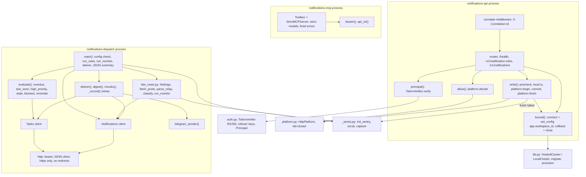

# 07 — C4 Component

Sources: `src/solo_notifications/app.py`, `src/solo_notifications/auth.py`, `src/solo_notifications/platform.py`, `src/solo_notifications/db.py`, `src/solo_notifications/_sentry.py`, `src/solo_notifications/dispatch.py`, `src/solo_notifications/tibo_reset.py`, `src/solo_notifications/mcp_server.py`, `src/solo_notifications/__init__.py`

หมายเหตุ: `Platform.publish` (`/v1/graph/events`) มีใน `platform.py` แต่ `app.py` ไม่เรียก — cell นี้ไม่ publish graph events ตาม README
