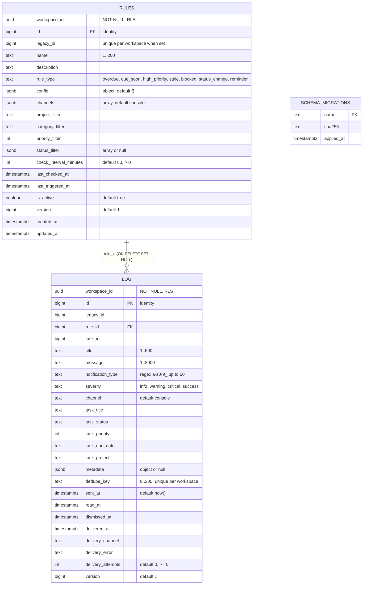

# 09 — ERD

Sources: `migrations/0001_notifications.sql`, `src/solo_notifications/db.py` (`migrate` creates `public.schema_migrations`)

## Indexes, RLS, grants

- `rules_legacy` unique `(workspace_id, legacy_id)` where not null; `log_dedupe` unique `(workspace_id, dedupe_key)` where not null; `log_type_sent`, `log_pending` (where `delivered_at IS NULL`), `log_task`
- FK เป็นแบบ composite `(workspace_id, rule_id)` → `rules (workspace_id, id)` จึงข้าม workspace ไม่ได้
- RLS `ENABLE` + `FORCE` บนทั้งสองตาราง; `notifications_api` ได้ SELECT, INSERT, UPDATE (ไม่มี DELETE)
- ไม่มี foreign key ไปยัง task (`task_id` เป็นเลข task ของ tasks cell, ข้าม DB) และไม่มี workspace table (workspace มาจาก claim `ws`)

Sources: `migrations/0001_notifications.sql`, `db/roles.sql`

## Data ที่เป็น "state" ในตาราง log

- Tibo monitor marker: แถว `notification_type = tibo_reset_monitor_state`, `channel = console`, dedupe_key ใช้ค่าคงที่ `STATE_KEY` ใน `tibo_reset.py`, `metadata.started_at` (ไม่มีตารางแยก)
- reminder: `metadata.task_uuid`, `metadata.reminder_at`

Sources: `src/solo_notifications/tibo_reset.py` (`STATE_KEY`, `run_monitor`), `src/solo_notifications/dispatch.py` (`_entry`)

## Open questions

- PRODUCT.md บอกว่า import 6 rules พร้อม legacy id; จำนวนแถวปัจจุบันใน production ไม่ทราบจาก repo
