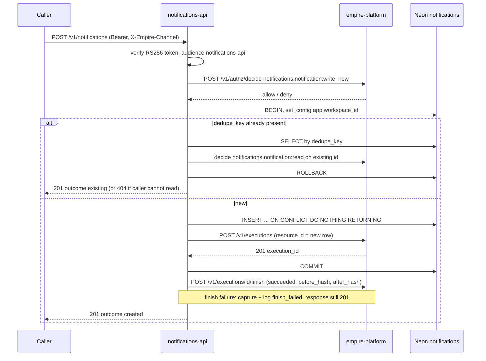
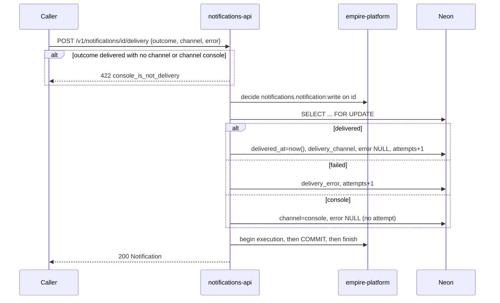
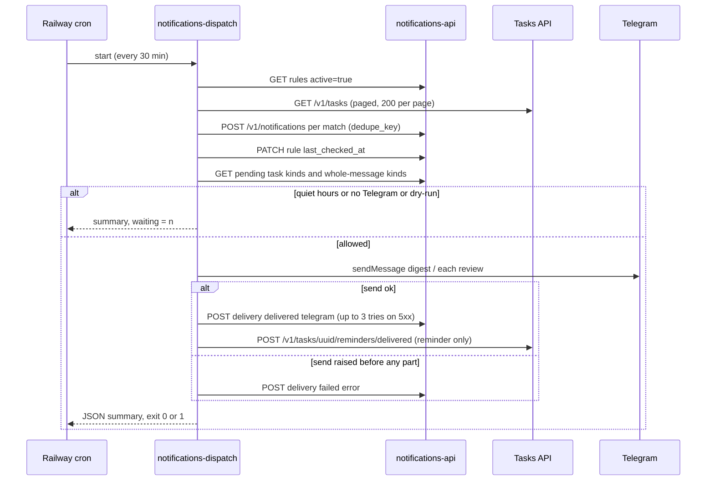
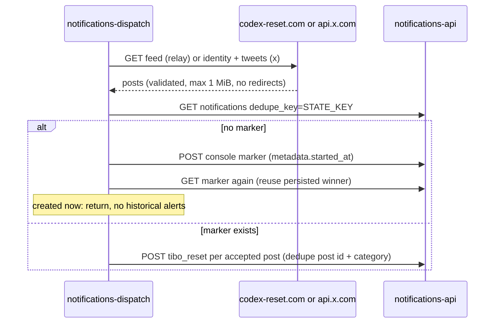

# 10 — Sequences

## S1 — Queue a notification (`POST /v1/notifications`)

Sources: `src/solo_notifications/app.py` (`queue`, `write`, `allow`, `bound`, `audit`), `src/solo_notifications/platform.py`, `src/solo_notifications/auth.py`

## S2 — Record a delivery result

Sources: `src/solo_notifications/app.py` (`record_delivery`, `Delivery`)

## S3 — Dispatcher delivery run

Sources: `src/solo_notifications/dispatch.py` (`main`, `run_rules`, `Tasks.list`, `deliver`, `_record`, `telegram_sender`)

## S4 — Tibo monitor first and later runs

Sources: `src/solo_notifications/tibo_reset.py` (`_get`, `fetch_posts`, `run_monitor`)
