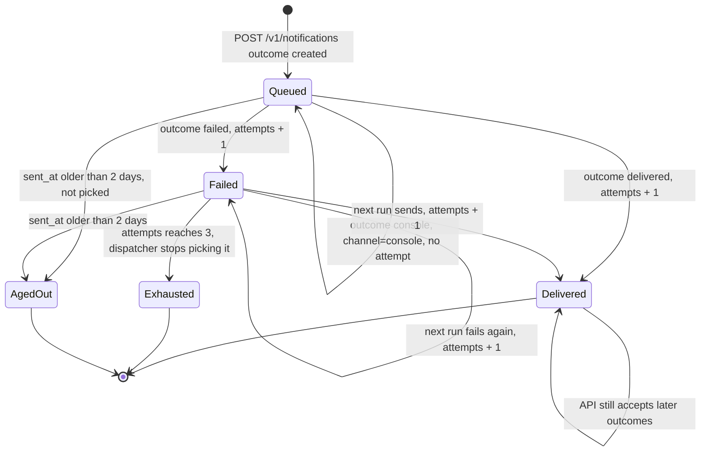
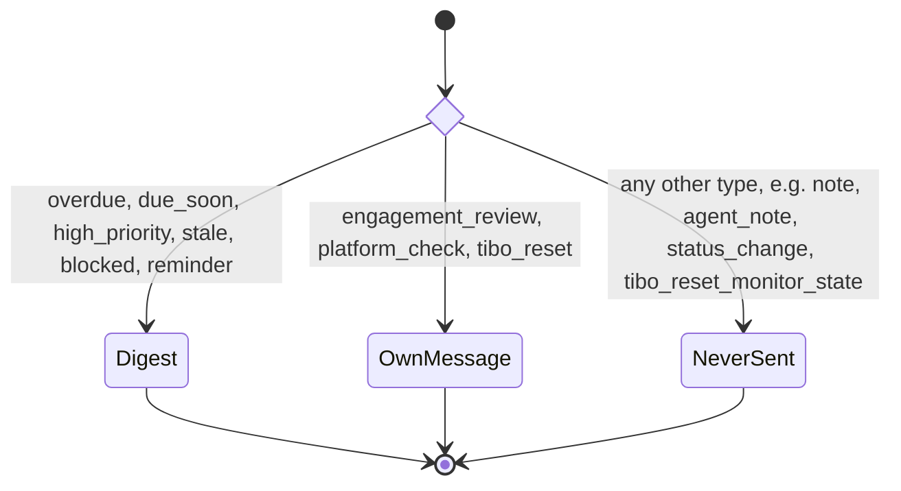
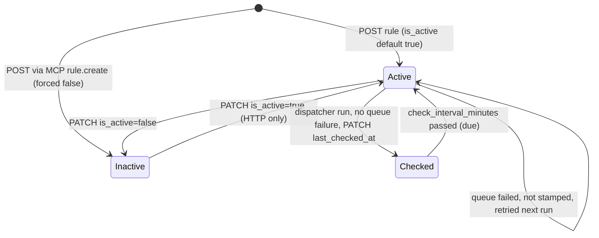
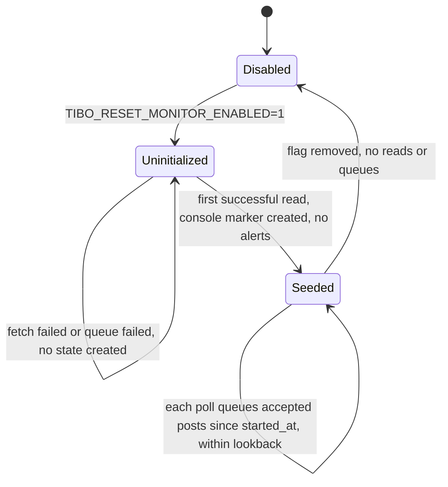

# 11 — State machines

ไม่มีคอลัมน์ `status` เดียว: สถานะของ log entry มาจาก `delivered_at`, `delivery_error`, `delivery_attempts`, `channel` และ `sent_at` ส่วน rule มี `is_active` + `version`. ชื่อ state ด้านล่างเป็นชื่ออธิบาย ไม่ใช่ค่าที่เก็บใน DB; ค่าที่ API ยอมรับจริงคือ delivery `outcome` = `delivered | failed | console` และ queue `outcome` = `created | existing`

## Notification log entry (as seen by the dispatcher)

Sources: `src/solo_notifications/app.py` (`queue`, `record_delivery`), `src/solo_notifications/dispatch.py` (`Notifications.pending` with `undelivered=true`, `max_attempts=MAX_ATTEMPTS`, `since=now-2 days`; `deliver`)

ข้อสังเกตที่ตรงกับโค้ด:

- `record_delivery` ไม่ตรวจ state เดิม: entry ที่ delivered แล้วยังรับ `failed` ได้ (attempts + 1, `delivered_at` คงอยู่) และ `console` ไม่กันการส่ง — dispatcher เลือก pending จาก `notification_type` + `delivered_at IS NULL` ไม่ได้ดู `channel`
- Partial send ของข้อความยาวที่ส่งไปบางส่วนแล้ว: log `partial_send` แล้ว **บันทึกเป็น delivered** เพื่อไม่ส่งซ้ำ (`tests/test_dispatch.py::test_a_partly_sent_review_is_not_resent`)
- ไม่มี state สำหรับ read / dismissed ในทางปฏิบัติ (`read_at`, `dismissed_at` ไม่มี route ตั้งค่า — gap)
- Exhausted และ AgedOut ไม่มีการแจ้งหรือ metric (gap; PRODUCT.md ตั้งเป้า exhausted = 0 แต่ไม่มีตัววัด)

## Which kinds can reach Telegram

Sources: `src/solo_notifications/dispatch.py` (`TASK_KINDS`, `WHOLE_MESSAGE_KINDS`), `src/solo_notifications/mcp_server.py` (`NoteKind`)

## Rule

Sources: `src/solo_notifications/app.py` (`create_rule`, `update_rule`), `src/solo_notifications/dispatch.py` (`due`, `run_rules`), `src/solo_notifications/mcp_server.py` (`rule_create`)

ทุก PATCH เพิ่ม `version` เมื่อมี field เปลี่ยน; `expected_version` ไม่ตรง = 409 `version_conflict`. dispatcher PATCH โดยไม่ส่ง `expected_version`

## Tibo reset monitor

Sources: `src/solo_notifications/tibo_reset.py` (`Settings.from_env`, `run_monitor`), `README.md` §Tibo reset alerts
