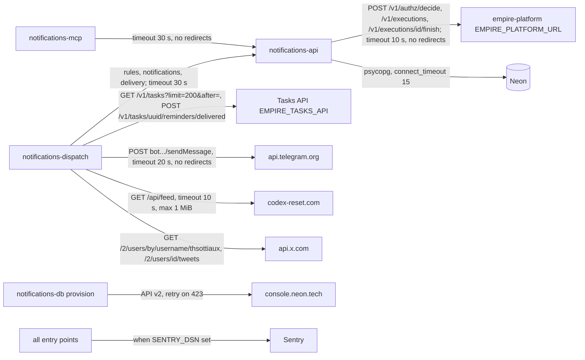

# 12 — API & integrations

## Endpoints (`notifications-api`)

| Method | Path | Permission asked (resource) | Notes |
|---|---|---|---|
| GET | `/health` | none | `{"status":"ok"}`; ไม่แตะ DB |
| GET | `/v1/notification-rules` | `notifications.rule:read` (`rule`, `*`) | filter `active`, `rule_type`; order by id |
| POST | `/v1/notification-rules` | `notifications.rule:write` (`rule`, `new`) | 201; `legacy_id` optional |
| GET | `/v1/notification-rules/{rule_id}` | `notifications.rule:read` (id) | deny = 404 |
| PATCH | `/v1/notification-rules/{rule_id}` | `notifications.rule:write` (id) | `expected_version` → 409 `version_conflict` |
| GET | `/v1/notifications` | `notifications.notification:read` (`notification`, `*`) | `notification_type` (repeatable), `since`, `until`, `task_id`, `rule_id`, `undelivered`, `max_attempts` (`delivery_attempts < n`), `dedupe_key`, `order`, `limit` 1..1000 (500), `offset` |
| GET | `/v1/notifications/stats` | `notifications.notification:read` | `group_by` = `notification_type`, `severity`, `channel`; `since` |
| GET | `/v1/notifications/{id}` | `notifications.notification:read` (id) | deny = 404 |
| POST | `/v1/notifications` | write (`new`) + read on an existing dedupe hit | 201 `{outcome: created or existing, notification}` |
| POST | `/v1/notifications/{id}/delivery` | `notifications.notification:write` (id) | `outcome` `delivered` / `failed` / `console` |

Error mapping (`app.py`): 401 `unauthenticated`, 403 `deny`, 404 `not_found`, 409 `conflict` / `version_conflict`, 422 `invalid_value` / `reference_not_found`, 503 `unavailable` (DB connect) / `authorization_unavailable` (platform)

Sources: `src/solo_notifications/app.py`, `README.md` §API

## Outbound integrations

Sources: `src/solo_notifications/platform.py` (`HttpPlatform`), `src/solo_notifications/db.py` (`HostedCluster.connect`, `_neon`), `src/solo_notifications/dispatch.py` (`Http`, `Tasks`, `telegram_sender`), `src/solo_notifications/tibo_reset.py` (`_get`, `fetch_posts`), `src/solo_notifications/mcp_server.py` (`main`), `src/solo_notifications/_sentry.py`, `src/solo_notifications/__init__.py`

## Retry behaviour (exact)

| Path | Retries? | Detail |
|---|---|---|
| Record delivery result (`_record`) | yes, in-run | up to 3 tries, only on HTTP status >= 500, sleep 2 s then 4 s; 4xx or 3rd failure = count error, log `record_failed`, move on |
| Telegram send failure | across runs | entry recorded `failed`; picked again next run while `delivery_attempts < 3` and `sent_at` within 2 days; no in-run retry |
| Queue failure in `run_rules` | across runs | rule not stamped, so evaluated again next run |
| Tibo queue / source failure | across runs | no state created on failed fetch; failed queue retried next poll via dedupe |
| Lost reminder acknowledgement | across runs | next run `_already_delivered` acknowledges without resending |
| Neon provision API | yes | HTTP 423 retried up to 15 times, 2 s apart |
| empire-platform decide / begin / finish | no | fail closed (503 / 401 / 403); `finish` failure captured and logged only |
| Tasks API, notifications API reads from dispatcher | no | `ApiError` per rule or whole run |
| MCP calls | no | fixed error to client |

Sources: `src/solo_notifications/dispatch.py`, `src/solo_notifications/tibo_reset.py`, `src/solo_notifications/db.py`, `src/solo_notifications/app.py`, `src/solo_notifications/mcp_server.py`

## Inbound callers

- `platform-mcp-remote-worker`, owner CLI / ops-toolkit client (ผ่าน gateway ตาม ops record: api-gateway-edge (2026-11-03))
- empire-platform `monitor.py` เขียน `platform_check` (`EMPIRE_NOTIFICATIONS_API` + platform-monitor automation)
- `platform-uptime-worker` → `/health`

ไม่มี webhook ขาเข้า, ไม่มี OpenAPI contract file ใน repo (FastAPI สร้าง `/openapi.json` อัตโนมัติ)
