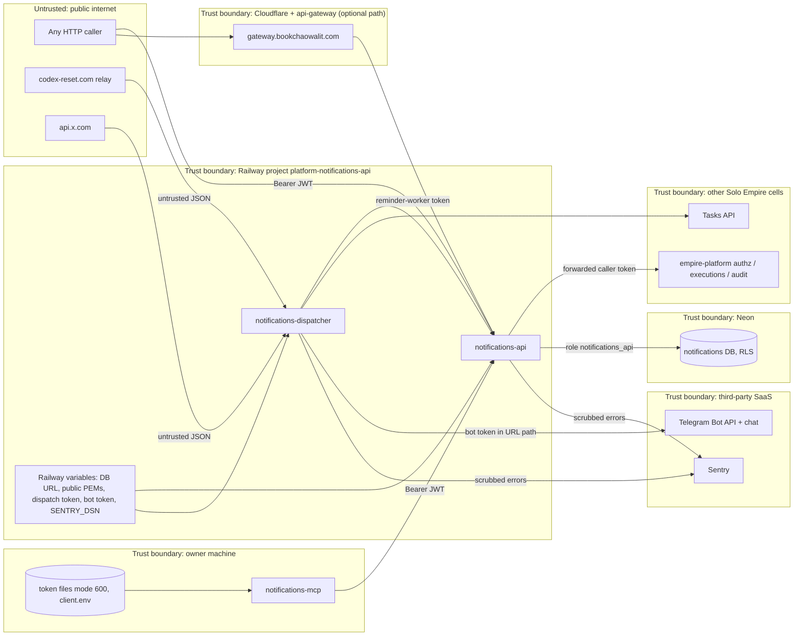

# 13 — Threat model (DFD + STRIDE)

## DFD with trust boundaries

Sources: `src/solo_notifications/auth.py`, `app.py`, `platform.py`, `dispatch.py`, `tibo_reset.py`, `mcp_server.py`, `_sentry.py`, `db.py`, `.railway/railway.ts`, `migrations/0001_notifications.sql`, ops record: api-gateway-edge (2026-11-03)

## STRIDE per element

| Element | Threat | Existing mitigation (in code) | Gap |
|---|---|---|---|
| notifications-api | **S** forged / foreign token | RS256 only, issuer + audience `notifications-api` checked, claims exp, iat, sub, jti required, `ws` must be a UUID; hosted mode refuses issuer `empire-platform-dev`; token also re-checked by platform on every decide | ไม่มี revocation list ในเครื่อง (พึ่ง platform) |
| notifications-api | **S** long-lived stolen token | owner tokens (no `del`) max 1 h; delegated max 30 days | token automation 30 วันมีอายุยาว |
| notifications-api | **T** cross-workspace write | RLS FORCE + `app.workspace_id` per transaction; composite FK; runtime role NOBYPASSRLS, no DELETE | — |
| notifications-api | **R** unattributed change | execution per write bound to resource id, `before_hash` / `after_hash`; `X-Correlation-Id` | `finish` failure leaves execution open (logged + Sentry only) |
| notifications-api | **I** dedupe-key probing reveals entries | existing entry returned only after a read decision, else 404 (`test_existing_entry_is_returned_only_to_readers`) | — |
| notifications-api | **I** errors leak secrets | Sentry: no locals, no request body / URL / headers, scrub URL passwords, bearer, JWT; tracing off; `Principal.__repr__` hides token | — |
| notifications-api | **D** request flood | uptime only; gateway rate limit 60 req / 10 s per IP when called through gateway (ops record) | direct `*.up.railway.app` URL ไม่มี rate limit ใน cell; gateway assertion ยังไม่ใช้กับ cell นี้ |
| notifications-api | **E** caller widens own rights | permissions decided by empire-platform per action; MCP has no identity args | API ไม่จำกัด `notification_type` / `channel` สำหรับผู้มี write (MCP จำกัดเอง) |
| empire-platform link | **T/S** redirect or MITM | `https` enforced (http only loopback), `follow_redirects=False`, fail closed | — |
| Neon DB | **I** URL leak | URLs from Railway vars or owner-only file (refuses mode with group/other bits); `channel_binding=require` | ไม่มี encryption-at-rest config ใน repo (ขึ้นกับ Neon) |
| notifications-dispatcher | **S/I** bot token leak | token format checked without echo; Telegram errors reduced to `telegram_http_<code>` / class name (URL carries token); no redirects | — |
| notifications-dispatcher | **T** malicious relay / X content | envelope version, profile handle, freshness 2 h, max 1000 posts, 1 MiB cap, URL pattern, no retweets, redirects rejected, `trust_env=False`; X credentials only to `api.x.com` | relay เป็น third party: ข้อความโพสต์ถูกส่งต่อเข้า Telegram ตามเดิม (ไม่ใช่การยืนยันโควตา — ระบุในข้อความแล้ว) |
| notifications-dispatcher | **D** one bad rule blocks run | per-rule / per-entry try, Sentry once per kind | dispatcher ล้มทั้งรอบไม่มี heartbeat (ดู 20) |
| notifications-dispatcher | **R** duplicate sends | dedupe per rule/task snapshot/day; partial sends recorded delivered; at-least-once documented | ข้อความอาจถูกส่งซ้ำถ้าบันทึกผลไม่สำเร็จ (by design) |
| notifications-mcp | **E** agent causes outside message | console-only note kinds, inactive rule create, no rule update, read-only mode | — |
| notifications-mcp | **I** upstream error text | fixed message from status only; tokens with whitespace/control chars refused | — |
| CI / supply chain | **T** dependency tampering | `uv.lock` + `uv sync --frozen`; reusable workflows SHA-pinned; gitleaks, semgrep, osv-scanner, trivy-fs; Renovate | `main` ไม่มี branch protection (`gh api .../protection` = 404) |

Sources: เหมือน DFD + `Dockerfile`, `.github/workflows/ci.yml`, `renovate.json`, `tests/test_api.py`, `tests/test_rollover_key.py`, `tests/test_sentry.py`, `tests/test_mcp.py`, `tests/test_tibo_reset.py`

## Open questions

- ใช้ gateway assertion (SPEC-002 ของ gateway) กับ cell นี้เมื่อไร — ตอน 2026-11-03 มีแค่ habits ที่เป็น pilot (ops record: api-gateway-edge)
- Telegram chat id / bot เป็นตัวไหนใน production (DOCPACK บอกว่า token เดิมถูก revoke — `[ต้องยืนยัน]`)
