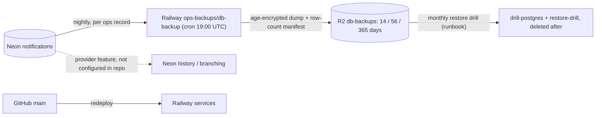

# 14 — Backup & DR

## Data inventory

| Data | Where | Recreatable? |
|---|---|---|
| `notifications.rules` (6 imported rules + any new) | Neon project `platform-notifications-api`, db `notifications` | ไม่ — config ของ owner |
| `notifications.log` (queued entries, delivery results, Tibo marker) | same | บางส่วน — dedupe ทำให้คิวใหม่ได้ แต่ประวัติการส่งหาย; ถ้า Tibo marker หาย monitor จะ seed ใหม่โดยไม่ส่งย้อนหลัง |
| `public.schema_migrations` | same | ได้ จาก `migrations/` |
| Secrets (DB URLs, PEMs, bot token, dispatch token) | Railway variables, owner-only `~/.config/solo-notifications/db.env` | ไม่อยู่ใน repo |
| Code + image | GitHub `main`, Railway builds | ได้ |

Sources: `README.md`, `PRODUCT.md`, `src/solo_notifications/db.py` (`provision`, `migrate`, `SECRETS`), `migrations/0001_notifications.sql`, ops record: prod-baseline-monitoring-backups (2026-11-03) — "The 30 Neon DBs are backed up by Railway `ops-backups/db-backup`", platform-db-backup `README.md` (`BACKUP_URL_<NAME>` per target)

## Restore reality

- Schema: `notifications-db migrate` บน DB ว่าง (roles ผ่าน `provision` หรือ `db/roles.sql`)
- Data: restore dump จาก R2 ตาม runbook ของ platform-db-backup (ไม่มี runbook เฉพาะใน repo นี้)
- Service: Railway redeploy deployment เก่า (README) หรือ merge ลง `main`

## RTO / RPO

- RTO: not defined
- RPO: not defined (ถ้ารวมอยู่ใน nightly backup จริง RPO โดยปริยาย ≤ 24 h)

## Open questions

- ฐานข้อมูล `notifications` อยู่ในรายการ `BACKUP_URL_*` ของ `ops-backups/db-backup` จริงหรือไม่ — ops record บอก "30 Neon DBs" แต่ไม่ระบุชื่อ และรายการอยู่ใน Railway variables ไม่อยู่ใน git
- เคย restore drill DB นี้แล้วหรือยัง
- Neon PITR / history retention ของ project นี้ตั้งไว้เท่าไร
