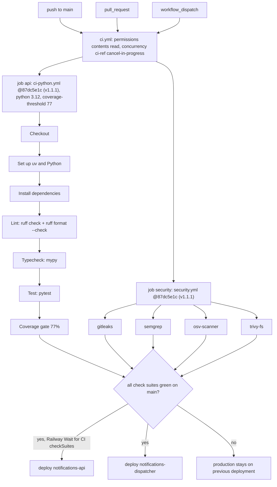

# 15 — CI/CD pipeline

Sources: `.github/workflows/ci.yml`, platform-ci-workflows `.github/workflows/ci-python.yml` and `.github/workflows/security.yml` at `87dc5e1c7e0416886a6371d5a101bb2ccba38edd` (jobs `python`; `gitleaks`, `semgrep`, `osv-scanner`, `trivy-fs`), `.railway/railway.ts` (`checkSuites: true`), `README.md` §Develop and operate

หมายเหตุ:

- runner = ค่าเริ่มต้นของ reusable workflow `"ubuntu-24.04"` (repo public, GitHub-hosted)
- `postgres` input ไม่ได้เปิด — tests ใช้ embedded PostgreSQL จาก `pgserver` (dev extra) ซึ่งเป็นเหตุผลที่ใช้ Python 3.12 ใน CI แต่ image ใช้ 3.13
- `tests/test_e2e_platform.py` ถูกข้ามใน CI (ไม่มี `platform_api`)
- ไม่มี deploy smoke / `/health` check หลัง deploy ใน workflow (AGENTS.md ให้ตรวจด้วยมือ) — gap
- ไม่มี migration step อัตโนมัติ — gap/open question (ดู 16)
- ops record: railway-deploy-approval-gate (2026-11-03) บอกว่าตั้งแต่ ~2026-10-28 GitHub deploys บน Railway บางบริการค้างที่ `NEEDS_APPROVAL`; commit ล่าสุดของ repo นี้ (2026-10-24) อยู่ก่อนช่วงนั้น จึงยังไม่ทราบว่ากระทบ repo นี้หรือไม่
