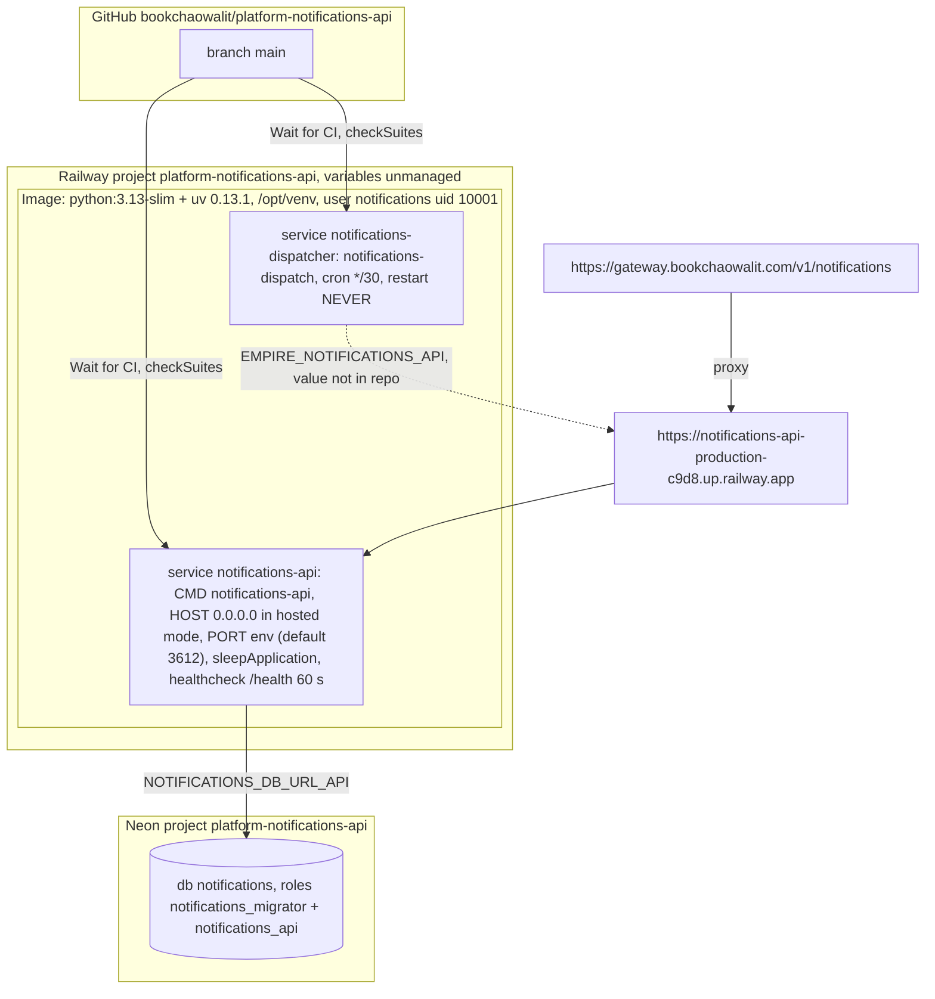

# 16 — Deployment

Sources: `.railway/railway.ts`, `Dockerfile`, `src/solo_notifications/app.py` (`main`: `HOST`, `PORT`, hosted-mode checks), `src/solo_notifications/db.py` (`HostedCluster`), `PRODUCT.md` §Operating Context (production URL), `README.md`, ops record: api-gateway-edge (2026-11-03) for the gateway route

## Environment (names only, from repo)

- API: `NOTIFICATIONS_DB_MODE=hosted`, `NOTIFICATIONS_DB_URL_API`, `NOTIFICATIONS_JWT_PUBLIC_KEY_PEM`, optional `NOTIFICATIONS_JWT_NEXT_PUBLIC_KEY_PEM` (rollover), `NOTIFICATIONS_JWT_ISSUER`, `EMPIRE_PLATFORM_URL`, `SENTRY_DSN`
- Dispatcher: `EMPIRE_TASKS_API`, `EMPIRE_NOTIFICATIONS_API`, `NOTIFICATIONS_DISPATCH_TOKEN`, `TELEGRAM_BOT_TOKEN`, `TELEGRAM_CHAT_ID`, optional `TIBO_RESET_*`, `X_BEARER_TOKEN`, `TIBO_X_USER_ID`
- Sentry tags: `RAILWAY_SERVICE_NAME`, release from `RAILWAY_GIT_COMMIT_SHA`

Sources: `README.md`, `src/solo_notifications/app.py`, `dispatch.py`, `tibo_reset.py`, `_sentry.py`

## Open questions

- Railway region ของ project นี้ (Neon `provision` default `aws-ap-southeast-1`; Railway region ไม่อยู่ใน IaC)
- Migration รันอย่างไรตอน deploy — image มี `migrations/` และ `notifications-db migrate` แต่ไม่มี pre-deploy command ใน `railway.ts`; น่าจะรันมือ
- Dispatcher ชี้ `EMPIRE_NOTIFICATIONS_API` ไปที่ URL ตรงหรือ gateway (เส้นในภาพเป็นสมมติฐานจากค่า URL production; ไม่อยู่ใน repo)
