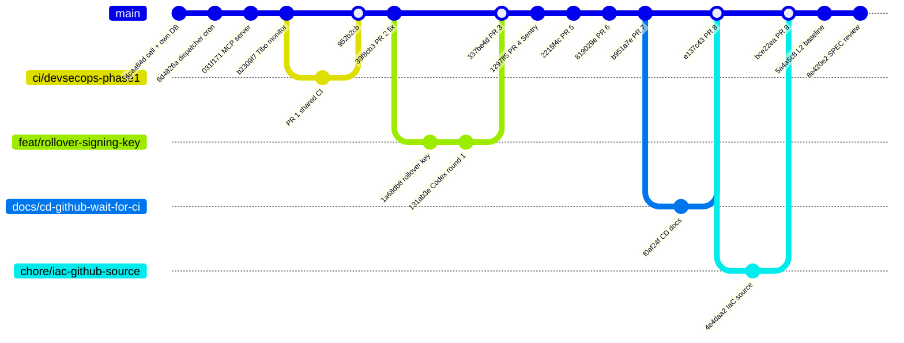
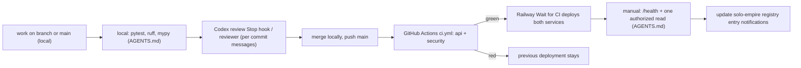

# 18 — Git & release workflow

ประวัติจริง: 2026-10-10 ถึง 2026-10-15 commit ตรงลง `main`; 2026-10-17 ถึง 2026-10-18 ใช้ PR #1–#9 (merge ใน local แล้ว push, บาง PR เป็น squash/fast-forward); 2026-10-22 และ 2026-10-24 commit ตรงลง `main` อีกครั้ง (SPEC-001 ระบุ "Main-only: committed straight to main")

Sources: `git log origin/main --first-parent`, `gh pr list --state all` (PR #1–#9 merged 2026-10-17..18), `specs/001-l2-baseline/spec.md`

## Path to production

Sources: `AGENTS.md`, `README.md` §Develop and operate, `.railway/railway.ts`, `.github/workflows/ci.yml`, commit `131ab3e` ("Codex round 1")

ข้อเท็จจริง: `main` ไม่มี branch protection และไม่มี ruleset (`gh api repos/.../branches/main/protection` = 404, rulesets = `[]`); ไม่มี tag / release

## Open questions

- Branch `origin/docs/cd-github-wait-for-ci` ยังค้างอยู่หลัง merge — ลบได้หรือไม่
