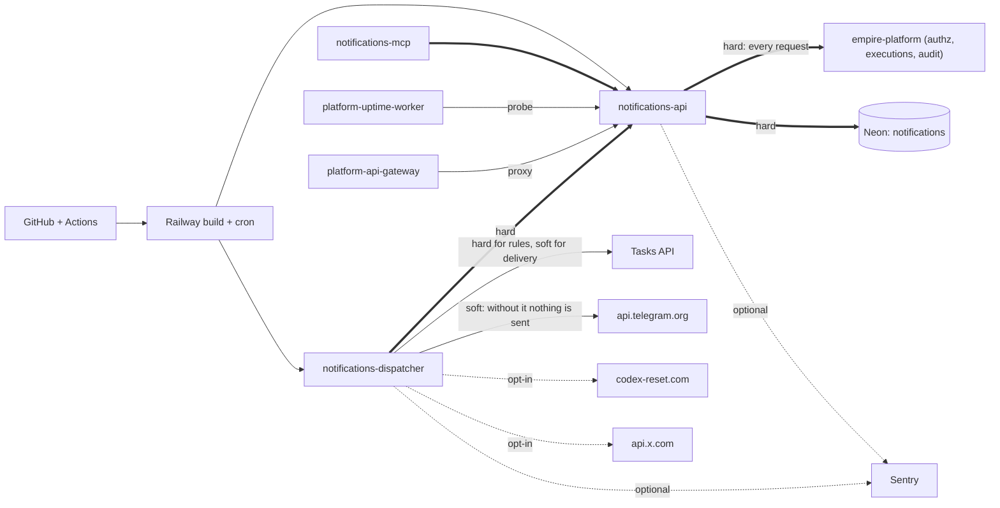

# 19 — Service dependency map

`==>` = ล้มแล้ว feature หลักใช้ไม่ได้, `-->` = ลดความสามารถ, `-.->` = เลือกใช้

Sources: `src/solo_notifications/app.py` (`allow`, `write`, `bound`), `src/solo_notifications/dispatch.py` (`main`: rules failure counted, delivery still attempted; `deliver`), `src/solo_notifications/tibo_reset.py`, `src/solo_notifications/_sentry.py`, `src/solo_notifications/mcp_server.py`, `.railway/railway.ts`, platform-uptime-worker `src/targets.ts`, ops record: api-gateway-edge (2026-11-03)

## Failure impact (from code)

| Dependency down | Effect |
|---|---|
| empire-platform | every API route except `/health` → 503 `authorization_unavailable`; dispatcher fails too (it calls the API) |
| Neon | 503 `unavailable` on connect |
| Tasks API | rules fail (`rule_failed`); pending entries still delivered; reminder ack fails and is retried next run |
| Telegram | entries recorded `failed`, retried up to 3 attempts |
| Relay / X | monitor counts an error; other delivery unaffected (`test_source_and_task_rule_outages_do_not_prevent_pending_delivery`) |

Known upstream incident: ops record railway-deploy-approval-gate (2026-11-03) — Neon `empire-platform` quota exhausted 2026-10-28 → 2026-11-01, "tasks-api ... down"; ตามโค้ดช่วงนั้น dispatcher จะประเมินกฎไม่ได้ (ไม่มี log ของ run จริงใน repo)
