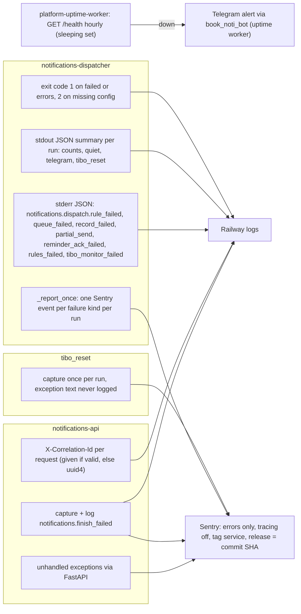

# 20 — Observability

Sources: `src/solo_notifications/app.py` (`correlate`, `write`), `src/solo_notifications/dispatch.py` (`_log`, `_report_once`, `main`), `src/solo_notifications/tibo_reset.py` (`run_monitor`), `src/solo_notifications/_sentry.py` (`init_sentry`, `capture`), platform-uptime-worker `src/targets.ts` (`notifications-api` target, `SLEEPS`), ops record: prod-baseline-monitoring-backups (2026-11-03) for uptime alerts to Telegram

## What is watched vs. not

| Signal | Status |
|---|---|
| API reachability | watched: uptime worker hourly (`/health` returns static `ok`, does not touch DB or platform) |
| API errors | Sentry if `SENTRY_DSN` set (Railway variable) |
| Dispatcher ran on schedule | **gap**: no heartbeat (uptime worker heartbeat list has no dispatcher job) |
| Dispatcher failed run (exit 1) | only in Railway logs / cron status; no alert in code |
| Delivery health (exhausted entries, aged-out entries, quiet-hour sends) | **gap**: no metric; `/v1/notifications/stats` gives counts by type / severity / channel only |
| 5xx rate, p95 latency (PRODUCT.md measure) | **gap**: tracing disabled (`traces_sample_rate=None`), no metrics exporter |
| Product analytics | none |

## Open questions

- `SENTRY_DSN` ตั้งไว้บนทั้งสองบริการใน production หรือไม่ (ops record บอก Sentry live 35 repos แต่ไม่ระบุ repo นี้)
- ควรเพิ่ม heartbeat ให้ dispatcher (รูปแบบเดียวกับ `token-rotate`, `posture-monitor`) หรือไม่
