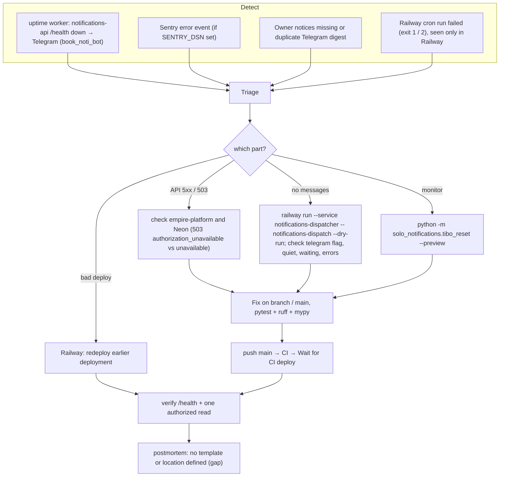

# 21 — Incident response

ไม่มี runbook เฉพาะใน repo; flow นี้ประกอบจาก alert channel ที่มีจริงและขั้นตอนที่ README / AGENTS.md ระบุ

Sources: `README.md` §Develop and operate (dry-run, rollback), `AGENTS.md` (verify `/health` + one authorized read), `src/solo_notifications/dispatch.py` (`main` exit codes, summary fields), `src/solo_notifications/tibo_reset.py` (`--preview`), `src/solo_notifications/app.py` (503 codes), platform-uptime-worker `src/targets.ts`, ops record: prod-baseline-monitoring-backups (2026-11-03)

## Self-healing already in code

- Failed sends retry on later runs (≤ 3 attempts); lost delivery records retried in-run on 5xx; lost reminder acks repaired next run; failed queues keep the rule due
- Rollback of Tibo monitor: unset `TIBO_RESET_MONITOR_ENABLED` (README)

## Gaps

- No dispatcher heartbeat, so "cron stopped" is not detected
- No on-call / severity definition, no postmortem template
- Duplicate sends possible by design (at-least-once) — no dedupe on the Telegram side

## Open questions

- ใครดู Railway cron failures และ Sentry issues ของ repo นี้ (มี alert rule ใน Sentry หรือไม่)
