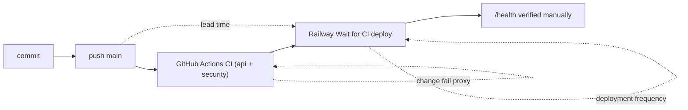

# 22 — DORA metrics

หน้าต่าง: 90 วัน 2026-08-06 → 2026-11-04 (repo เริ่ม 2026-10-10 จึงมีข้อมูลจริง ~25 วัน). "Deploy" = push ลง `main` ที่ CI ผ่าน หลัง CD เปิด 2026-10-18 (Railway Wait for CI deploy ทุก push ที่เขียว, ไม่มี watch paths). ก่อน 2026-10-18 deploy ใช้ `railway up` ด้วยมือ ซึ่ง git นับไม่ได้. ยังไม่ได้เทียบกับประวัติ deployment ของ Railway

Sources: `.railway/railway.ts`, `README.md` §Develop and operate, `git log`, `gh run list`

| Metric | How measured here | Value (2026-11-04) | Command |
|---|---|---|---|
| Deployment frequency | green CI push runs on `main` since 2026-10-18 | **9** deploy candidates in 90 days (7 on 2026-10-18, 1 on 10-22, 1 on 10-24) ≈ 0.7 / week; none since 2026-10-24 | `gh run list -R bookchaowalit/platform-notifications-api --branch main --limit 100 --json headSha,createdAt,conclusion` |
| Lead time for changes | first commit of the change → its first-parent commit on `main` (+ CI run) | direct commits: 0 min; PR merges: 1, 6, 12 min (PR 9, 8, 3); squashed PRs 0 min. CI wall time not reliably given by `updatedAt`; Railway build time not measured | `for c in $(git log origin/main --since=2026-08-06 --first-parent --format=%H); do p=$(git rev-list --parents -n1 $c \| awk '{print $2}'); git log --format=%at $p..$c \| sort -n \| head -1; git log -1 --format=%ct $c; done` |
| Change fail rate | **proxy**: failed CI runs on `main` (a red run never deploys); true value needs Railway failed / rolled-back deployments | 0 / 11 push runs failed (and 0 / 10 PR runs) → proxy 0%; true value **not computable** | `gh run list -R bookchaowalit/platform-notifications-api --limit 200 --json conclusion,event` |
| Failed deployment recovery time | time from a failed deploy / incident to restore | **not computable**: no incident record, no Railway deployment history read, no failed deploy found | — |
| Deployment rework rate | **proxy**: `fix:` / `Revert` commits among main commits | 11 / 34 first-parent commits in 90 days (32%); since CD 3 / 9 deploys (PR 5–7, Sentry hardening follow-ups to PR 4, same day) | `git log origin/main --since=2026-08-06 --first-parent --format=%s \| grep -ciE '^(fix\|revert)'` |

## Notes

- 34 first-parent commits on `main` in the window, all between 2026-10-10 and 2026-10-24
- One revert pre-CD: `2bd6c62` (reverted `44e873a` rename, then re-applied as `764f5e9` on 2026-10-13)
- `39f8cb3` fixed a behaviour change introduced by the CI-adoption lint commit (`952b2cb`) — a real regression caught one day later, before CD was on

## Open questions

- Railway deployment history (successful / failed / rolled back) สำหรับ `notifications-api` และ `notifications-dispatcher` เพื่อคำนวณ change fail rate และ recovery time จริง
- นิยาม "incident" สำหรับ cell นี้ (เช่น digest ไม่ออก > 1 run นอก quiet hours)
